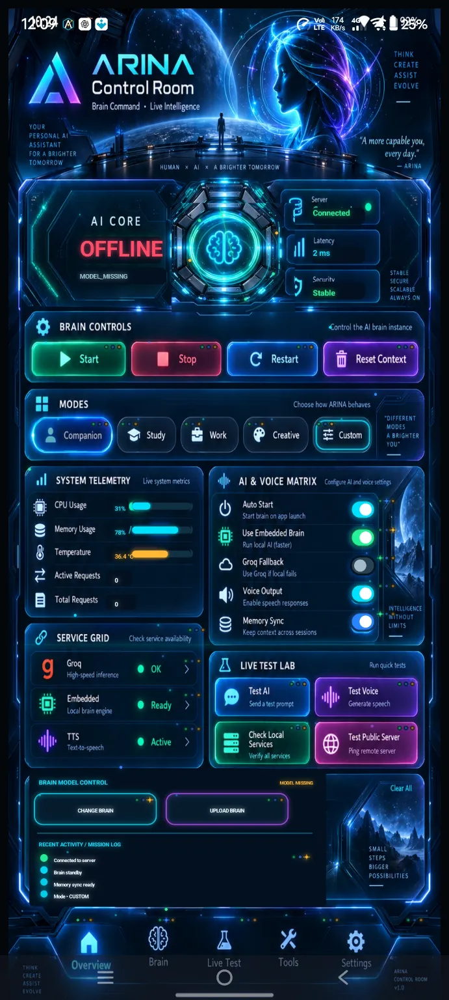
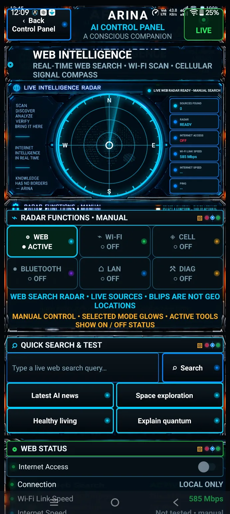
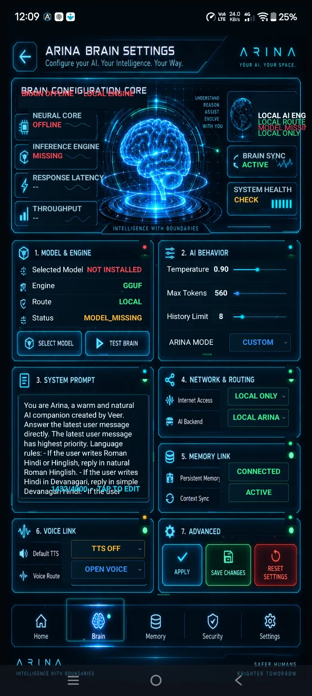

# Veer Creation Hub

**Independent Android tools and software projects.** Mobile-first static website for GitHub Pages. No hosting subscription, API key, payment card, server, or database is required for the website itself.

> **Status:** Platform files are prepared. No applications have been approved/listed. The site is not yet deployed to GitHub Pages. Github Sponsors is not yet activated or connected.

## Features

- Responsive catalog, Hindi / English / Hinglish, dark/light mode, accessible mobile drawer.
- Honest release check: direct APK links appear only if the selected **public repository's latest GitHub Release** has an APK asset.
- No fake download counts, revenue statistics, app versions, downloads, or project listings.
- `publisher.html` is an optional *local catalog file generator*. It **does not publish or authenticate**. Only someone with push access to the Pages repository can change the live site.
- No analytics trackers, cookies, or client-side tokens. Language/theme preference saved locally on the browser.
- Browsing uses the GitHub REST public Releases endpoint; when unavailable, it refuses to show a direct APK button.

## Publish site using the existing GitHub repository

Repository already created and verified: https://github.com/magic616star666-bot/Veer-creation- (Public, empty at preparation time).

1. In that repository, open **Add file → Upload files**. Unzip this package first, then upload the **contents**, including `index.html`, `assets/` and `publisher.html`, to the repository root.
2. Commit changes to `main`.
3. Open **Settings → Pages → Build and deployment → Deploy from a branch → main → /(root) → Save**.
4. Once deployment succeeds, open `https://magic616star666-bot.github.io/Veer-creation-/`.
5. The catalog intentionally starts at **zero published apps**.

Pages URL is not active until GitHub Pages has been enabled and deployment has succeeded.

Official docs: https://docs.github.com/en/pages/getting-started-with-github-pages/creating-a-github-pages-site

## Add the first app (later, when approved)

1. Only publish the app's source if you approve making it public and the chosen license is compatible with every dependency; keep credentials private.
2. Publish an actual tested APK file as a GitHub Release **asset** on the app's public repository.
3. Open `publisher.html` (works locally) and fill in the exact `owner/repository`, name, category and description.
4. The studio checks whether a latest public Release includes an `.apk`. Only then does it permit adding the app.
5. Download `apps-data.js` from Publisher Studio and replace `assets/apps-data.js` in the site repo. Commit.
6. Confirm the site shows the correct card and download URL.

**Important:** If you edit the catalog by hand, set `approved: true` only after verifying publication. Never enter private repository names.

## Sponsors

- Sponsors is separate from Pages. GitHub requires eligibility checks, payout onboarding and tax information (for India, PAN may be applicable).
- Never publish tax IDs, bank details or payment card information in a repository.
- When Github Sponsors is active, enter `https://github.com/sponsors/<actual-enabled-username>` in Publisher Studio and download the new `apps-data.js`. Until then the website explicitly says sponsorship is inactive.
- A public release or sponsor button does not guarantee revenue.

## Brand, licensing and app privacy

- **Site code** currently has no open-source license, as requested. Public visibility does not grant reuse permission; the owner can choose a license later.
- Each future app has its **own repository and explicit license decision**. A publicly downloadable APK does *not* automatically make that app open source.
- Always scan submitted ZIPs for secrets and examine third-party dependency licenses before publication.

## Structure

```text
index.html                   website
publisher.html               local catalog editor
assets/style.css             responsive design
assets/site.js               browsing, translations, API checks
assets/apps-data.js          public catalog & funding config (currently empty)
assets/publisher.js          catalog generator
assets/favicon.svg           vector logo
.github/ISSUE_TEMPLATE/      reusable issue forms
UPLOAD_GUIDE_HINDI.md        Hindi step-by-step setup
SECURITY.md                  safe publication rules
.nojekyll                    GitHub Pages static assets
```

## Technical validation

- No npm / SDK / build step. Use any static HTTP server or GitHub Pages.
- Directly opening `index.html` works because the catalog is a local JS file, not a `fetch()` of JSON.
- Release availability checks need an internet connection, and are subject to GitHub API rate limiting. If they fail, the site shows no APK link.

© 2026 Veer Creation

## ARINA App Screenshots

Original app captures supplied by VEER CREATION. Select any image to view it at its original resolution (691 × 1536). Status indicators reflect the moment of capture.

<a href="assets/arina/server-dashboard.jpg"></a>
<a href="assets/arina/server-sections.jpg"></a>
<a href="assets/arina/ai-control-panel.jpg"></a>
<a href="assets/arina/ai-control-room.jpg"></a>
<a href="assets/arina/voice-audio.jpg"></a>
<a href="assets/arina/web-intelligence.jpg"></a>
<a href="assets/arina/brain-settings.jpg"></a>

[Official APK release](https://github.com/magic616star666-bot/Veer-creation-/releases/tag/v1.0.0)
